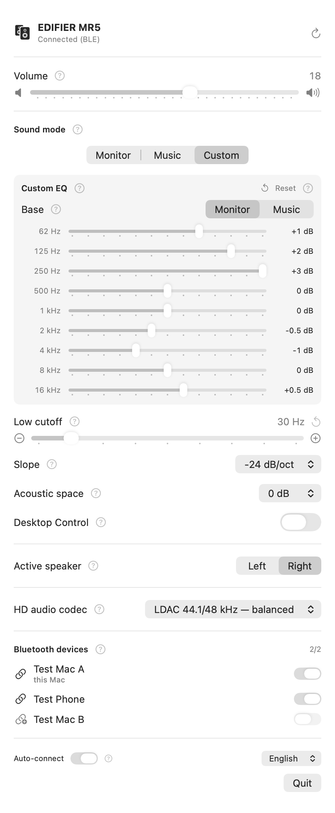

# EdifierBar — Edifier MR5 menu bar controller for macOS

A small SwiftUI `MenuBarExtra` app that controls an **Edifier MR5** studio monitor
over Bluetooth LE, replacing the Edifier ConneX phone app for everyday settings.

> **Tested only with the Edifier MR5** (firmware 1.0.3). It has **not been tested
> with the MR3** or any other Edifier model; they may use different commands.



Panel:
- connection status (BLE), device name
- **volume** (0–30)
- **sound mode**: Monitor / Music / Custom
- **custom EQ** (when Sound mode is Custom): 9 bands 62 Hz–16 kHz, −3…+3 dB, Monitor/Music base, reset
- **low cutoff** frequency (20–100 Hz, reset to 30 Hz) and slope (−6/−12/−18/−24 dB/oct)
- **acoustic space** (0 … −4 dB)
- **Desktop Control** on/off
- **active speaker channel** (left/right)
- **HD audio codec**: LDAC 96 kHz / 44.1–48 kHz / off (asks before switching, the speaker reconnects)
- **Bluetooth devices**: paired sources with on/off switches (max. 2 connected, "this Mac" marked)
- a (?) help button next to every control
- auto-connect switch: turn it off to release the speaker so ConneX on the phone can connect
- UI language: English (default) or Magyar, selectable at the bottom of the panel

The protocol was reverse-engineered from a ConneX Bluetooth capture; see
[PROTOCOL.md](PROTOCOL.md). The app only sends commands and values that appear in
that capture. Out-of-range values are refused in `MR5Protocol`. There are no
firmware, factory-reset or power commands.

## Requirements

- macOS 14 or newer, Apple Silicon or Intel
- Swift 5.10+ toolchain (Xcode or just the Command Line Tools: `xcode-select --install`)

## Build and run

```sh
./scripts/bundle.sh          # builds build/EdifierBar.app (release, ad-hoc signed)
open build/EdifierBar.app
```

On first launch macOS asks for Bluetooth permission. Allow it.
A speaker icon appears in the menu bar (filled = connected).

To install it permanently, copy `build/EdifierBar.app` to `/Applications` and
add it in System Settings › General › Login Items (or:
`osascript -e 'tell application "System Events" to make login item at end with properties {path:"/Applications/EdifierBar.app", hidden:false}'`).
After rebuilding, update the installed copy with
`pkill -x EdifierBar; ditto build/EdifierBar.app /Applications/EdifierBar.app && open /Applications/EdifierBar.app`.

Debug log (frames received from the speaker):

```sh
open build/EdifierBar.app --stdout /tmp/edifierbar.log --stderr /tmp/edifierbar.log
```

Layout snapshot (renders the panel with sample data, no Bluetooth, to `/tmp/panel-en.png` and `/tmp/panel-hu.png`):

```sh
open -n -W --env EDIFIERBAR_SNAPSHOT=/tmp/panel build/EdifierBar.app
```

Protocol self-check (verifies every frame builder against bytes from the capture):

```sh
swift run mr5-selftest
```

## Notes

- The MR5 accepts **one BLE controller at a time**. If ConneX on the phone is
  connected (or open in the background), the Mac won't find the speaker. Close
  ConneX, or turn off "Auto-connect" in the panel when you want to use the phone.
- Audio (A2DP) is independent: the Mac or phone can still play music over classic
  Bluetooth while the app is connected over BLE.
- Not implemented (not captured): EQ profile create/rename/share, power-saving, prompts,
  power off, unpair, factory reset.

## About the captures

The protocol was worked out from Bluetooth captures and screen recordings made
with **test devices** during development. In [PROTOCOL.md](PROTOCOL.md), the
self-test and the screenshots, their names and Bluetooth addresses are replaced
with placeholders ("Test Mac A", "Test Phone", …). The raw captures are not part
of this repository.

## Disclaimer

This is an unofficial, independent project. It is not affiliated with, endorsed
by or supported by Edifier. "Edifier", "MR5" and "ConneX" are trademarks of their
respective owner. Use at your own risk.

## License

[MIT](LICENSE)

## Layout

```
Sources/MR5Protocol/     frame format, checksum, parser, typed command builders
Sources/EdifierBar/      SwiftUI menu bar app + CoreBluetooth controller
Sources/mr5-selftest/    protocol checks against captured frames
scripts/bundle.sh        builds the .app bundle (needed for Bluetooth permission)
tools/                   discovery and btsnoop analysis scripts
PROTOCOL.md              protocol documentation
```
